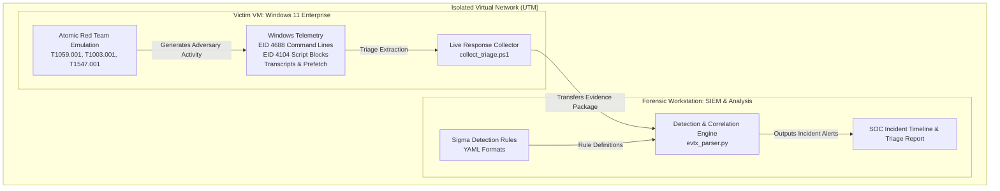

# Windows DFIR & Detection-as-Code Lab

[](https://github.com/Bassma202/windows-dfir-atomic-lab/actions)
[](https://opensource.org/licenses/MIT)
[](https://www.python.org/)
[](https://attack.mitre.org/)

> **Isolated 2-VM Digital Forensics & Incident Response (DFIR) environment on UTM/macOS. Features automated adversary emulation (Atomic Red Team), advanced Windows/PowerShell telemetry capture, custom Sigma detection rules, and incident reconstruction.**

---

## 1. Architecture & Environment

Built to replicate an enterprise SOC threat hunting & forensics pipeline in an isolated virtualization sandbox:

* **Victim System:** Windows 11 Enterprise (ARM64 under UTM virtualizer).
* **Forensic & Analysis Workstation:** SIFT / Forensic Linux VM.
* **Telemetry Configuration:**
  * Process Creation Auditing with Command Line Logging (**Event ID 4688**).
  * PowerShell Script Block Logging (**Event ID 4104**), Module Logging (**Event ID 4103**), and Transcription.
  * Sysmon (System Monitor) v15.0 for process ancestry and network connections.



---

## 2. Detection Coverage Matrix (MITRE ATT&CK)

| Technique ID | Name | Emulated Adversary Behavior | Telemetry Source | Sigma Rule | Severity |
| :--- | :--- | :--- | :--- | :--- | :--- |
| **T1059.001** | PowerShell: Encoded Command | `powershell.exe -ExecutionPolicy Bypass -enc <Base64>` | Security 4688 / Sysmon 1 | `proc_creation_win_powershell_base64_encoded.yml` | **HIGH** |
| **T1003.001** | OS Credential Dumping: LSASS | `rundll32.exe comsvcs.dll, MiniDump <PID>` | Security 4688 / Sysmon 10 | `proc_creation_win_lsass_dump_comsvcs.yml` | **CRITICAL** |
| **T1547.001** | Boot or Logon Autostart: Registry Run Keys | `reg.exe add HKCU\...\Run /v Backdoor /d payload.exe` | Sysmon 13 / Security 4657 | `registry_set_run_key_persistence.yml` | **MEDIUM** |
| **T1059.001** | In-Memory Web Cradle | `IEX (New-Object Net.WebClient).DownloadString(...)` | PowerShell 4104 | `posh_ps_scriptblock_suspicious_download.yml` | **HIGH** |
| **T1082** | System Information Discovery | `systeminfo /fo csv` execution by non-admin | Security 4688 / Sysmon 1 | Built-in Engine Rule | **LOW** |

---

## 3. Quickstart & Demonstration

### Step 1: Run Adversary Emulation (On Windows Target)
In an elevated PowerShell prompt:
```powershell
.\adversary_emulation\atomic_tests.ps1
```

### Step 2: Extract Live Triage Artifacts
```powershell
.\triage_collector\collect_triage.ps1 -OutputDir "C:\DFIR_Artifacts"
```

### Step 3: Run the Detection & Incident Timeline Engine
```bash
python3 triage_collector/evtx_parser.py \
    --input adversary_emulation/sample_telemetry.json \
    --output reports/incident_triage_report.json
```

### Step 4: Run Unit Tests
```bash
python3 -m unittest discover tests
```

---

## 4. Forensic Telemetry Findings & IOCs

During testing on Windows 11, the following high-fidelity artifacts were verified:
1. **PowerShell Script Block Logging (EID 4104):** Successfully recorded de-obfuscated script code even when executed with `-EncodedCommand` or obfuscated with backticks.
2. **Process Lineage (Parent-Child Tracking):** Identified `rundll32.exe` spawned directly from `cmd.exe` calling `comsvcs.dll MiniDump`, generating an immediate CRITICAL credential dumping alert.
3. **Persistence Verification:** Confirmed registry modification in `HKCU\Software\Microsoft\Windows\CurrentVersion\Run` with timestamp correlation to process creation events.

---

## 5. Author & Academic Context

* **Author:** **Bassma Alaoui Sossey**  
* **Degree:** Diplôme d'Ingénieur d'État en Cybersécurité  
* **Institution:** Université Euromed de Fès (UEMF), Morocco  
* **Specialization:** Digital Forensics & Incident Response (DFIR), SOC Operations, Detection Engineering
